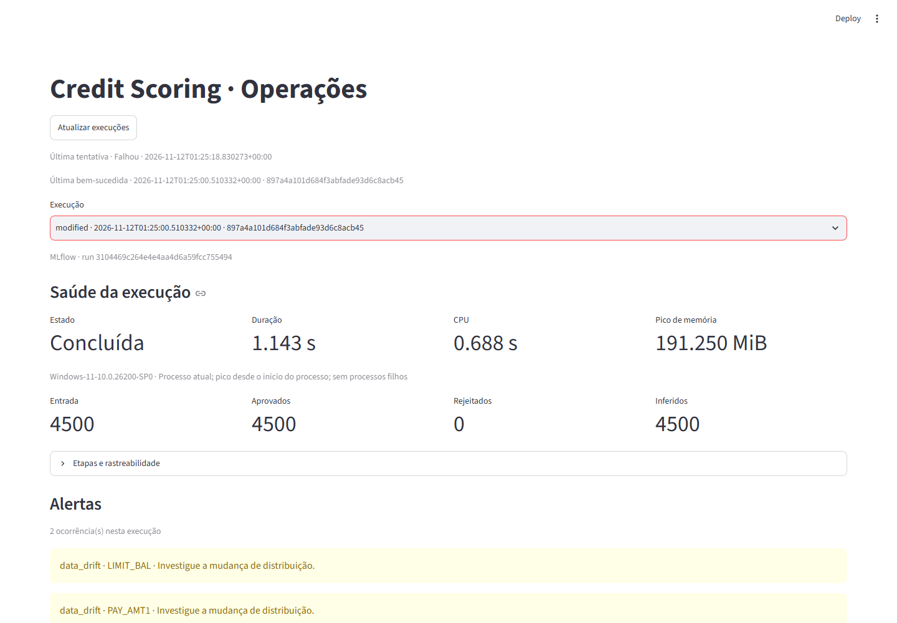

# Tech Challenge - Fase 4 | ML Engineering

[](https://github.com/fabiopolli/pos-ml-eng-tech-challenge-fase-04/actions/workflows/ci.yml)
[](https://www.python.org/)
[](https://docs.astral.sh/uv/)

Solução local e reproduzível de **Credit Scoring**, com contratos de qualidade de dados,
simulação e detecção de drift, rastreamento de experimentos e documentação de governança.

> **Status atual:** M1 (fase 1) concluído e revalidado; Data Drift da fase 2 implementado e
> verificado sob o protocolo `1.0.2`. O controle não gerou alertas; as intervenções detectaram
> `LIMIT_BAL` e `PAY_AMT1`. A aba didática Data Drift do laboratório (adendo ao 1.6-O6) está
> implementada; não substitui o dashboard operacional da fase 3.
> Concept Drift não é demonstrado; por decisão do operador, a docência avaliará o plano após a
> entrega, sem resposta prévia como gate de M2. As versões DVC `1.0.1` e `1.0.2` foram enviadas e
> recuperadas em cache isolado; o HTML ampliado v6 também foi enviado ao DagsHub e está versionado
> no Git, por ser entrega do tech challenge.
> Ver [`docs/evidence/fase-1.md`](docs/evidence/fase-1.md),
> [`docs/evidence/fase-2.md`](docs/evidence/fase-2.md) e
> [`docs/evidence/1.6-o6-data-drift-laboratorio.md`](docs/evidence/1.6-o6-data-drift-laboratorio.md).

## Equipe e frentes de trabalho

| Integrante | GitHub | Frente inicial |
|---|---|---|
| Fábio Polli | [`fabiopolli`](https://github.com/fabiopolli) | Repositório, arquitetura, CI e integração |
| Willian "Bill" Kopp | [`bill-kopp`](https://github.com/bill-kopp) | Plano técnico e modelagem |
| Denis Barros Melo | [`denisbmelo`](https://github.com/denisbmelo) | Engenharia e qualidade de dados |
| Romario Silva | [`romagrinho`](https://github.com/romagrinho) | Observabilidade, dashboard e integração |

O detalhamento de cada entrega fica em [`docs/CHECKLIST.md`](docs/CHECKLIST.md); a tabela acima é
o ponto de partida para a organização do trabalho em grupo.

## Objetivo

Demonstrar validação de dados, detecção de alterações de distribuição e monitoramento de um
modelo de risco de crédito em um cenário hipotético de fintech. O projeto usa o dataset público
**UCI Default of Credit Card Clients (ID 350)** e separa dados de referência dos lotes simulados
de produção; drift sintético não comprova perda real de desempenho.

O plano detalhado, com 28 entregas distribuídas em quatro semanas, está em
[`docs/plans/plano-de-trabalho-TC4.md`](docs/plans/plano-de-trabalho-TC4.md). O enunciado oficial
está em [`docs/plans/MLET - Tech Challenge - Fase 4.pdf`](docs/plans/MLET%20-%20Tech%20Challenge%20-%20Fase%204.pdf).

O plano geral também indexa os [quatro planos de execução agêntica](docs/plans/plano-de-trabalho-TC4.md#planos-de-execução-por-etapa),
com pacotes por ID, dependências, interfaces, verificações e transferência entre fases.

## Critérios oficiais

| Critério | Peso | Evidência mínima esperada |
|---|---:|---|
| Validação de Dados | 25% | Contrato com pelo menos três regras e lote inválido bloqueado |
| Detecção de Drift | 25% | Duas distribuições alteradas e relatório estatístico claro |
| Observabilidade e Logs | 20% | Métricas, logs, alertas e visualização do pipeline/modelo |
| Governança (LGPD) | 15% | Privacidade, base legal, retenção, riscos e mitigação |
| Vídeo STAR | 15% | Demonstração técnica objetiva com até cinco minutos |

## Dataset e estratégia de modelagem

O **Default of Credit Card Clients**, publicado pela UCI, possui 30.000 registros, 23
variáveis preditoras e alvo binário de inadimplência no mês seguinte. A configuração canônica
fica em [`configs/project.yaml`](configs/project.yaml).

- **Preditores iniciais:** 19 variáveis financeiras de limite, atraso, fatura e pagamento.
- **Governança:** sexo, escolaridade, estado civil e idade ficam fora do modelo inicial e são
  preservados para análises agregadas de qualidade e viés.
- **Split:** treino 70%, validação 15% e teste 15%, de forma estratificada e com seed fixa.
- **Baseline:** Regressão Logística com pré-processamento em pipeline.
- **Candidato:** Random Forest com parâmetros simples e controle de overfitting.
- **Seleção:** ROC-AUC como métrica principal; precision, recall, F1, accuracy e matriz de
  confusão como evidências complementares.

O protocolo planejado reserva o teste para avaliar apenas o modelo escolhido após congelar as
decisões. Toda transformação aprendida deve ser ajustada no treino. **Limitação registrada:** o
EDA executado antes da fase 1 calculou correlações com o alvo no bruto completo, incluindo as
linhas do conjunto de teste. A exposição está declarada em
[`docs/evidence/fase-1.md`](docs/evidence/fase-1.md) (seção 1.2.1) e o artefato histórico ficou
preservado em `reports/eda/history/`. A partir da fase 1, a exploração que orienta modelagem é
calculada **somente sobre o treino**, a seleção e a avaliação final são estágios separados e o
estágio de treino não lê o conjunto de teste. A avaliação final é, portanto, uma reavaliação
sob protocolo congelado — não uma avaliação intocada.

## Stack definida

| Finalidade | Tecnologia |
|---|---|
| Processamento | Pandas e NumPy |
| Modelagem | Scikit-learn: Regressão Logística e Random Forest |
| Contratos de dados | Pandera |
| Drift | Evidently AI e testes estatísticos |
| Experimentos | MLflow |
| Dashboard | Streamlit |
| Versionamento de datasets e modelos | DVC + DagsHub Storage |
| Qualidade | Pytest, Ruff e GitHub Actions |

O DVC rastreia dados e artefatos do pipeline; seus ponteiros e metadados ficam no GitHub,
enquanto os objetos publicados ficam no DagsHub Storage. Os outputs analíticos das versões `1.0.1`
e `1.0.2` foram publicados e recuperados em cache isolado. O HTML ampliado v6 também foi publicado
no DagsHub e está versionado no Git, por ser entrega do tech challenge. Veja
[`docs/DAGSHUB.md`](docs/DAGSHUB.md); nunca coloque tokens ou credenciais em arquivos versionados.

## Fluxo do pipeline

```text
UCI 350 (XLS, objeto DVC)
  -> aquisição versionada (hash conferido) -> CSV bruto
  -> auditoria estrutural do bruto
  -> preparação + split 70/15/15 + referência = treino
  -> exploração supervisionada no treino
  -> contrato Pandera antes do treino
  -> treino + seleção na validação -> modelo congelado
  -> avaliação do escolhido no teste (estágio separado)
  -> produção original = features da validação + cópia com drift (estágio `simulate_production`)
  -> contrato + inferência do modelo congelado (`score_production`)
  -> PSI customizado e relatório Evidently (controle e lote alterado; `detect_drift`)
  -> MLflow local + relatórios -> dashboard Streamlit
  -> laboratório Streamlit de comparação/teste e leitura agregada de Data Drift (plano 1.6 + adendo O6)

Datasets/modelo <-> cache DVC <-> DagsHub Storage
Código, parâmetros, ponteiros e dvc.lock -> GitHub
```

As decisões e fronteiras entre componentes estão em [`docs/ARCHITECTURE.md`](docs/ARCHITECTURE.md).

## Contratos, drift e observabilidade

### Contrato de dados

O contrato Pandera está **implementado** (`src/credit_monitoring/contracts/`) e é aplicado antes
de qualquer ajuste de modelo e antes de qualquer inferência. Um lote que viola uma regra rígida
é **rejeitado por inteiro**, com diagnóstico por regra, coluna e contagem — sem remover linhas e
sem imprimir valores de registro. As regras vêm do bloco `contract:` de `configs/project.yaml`:

- identificador único no lote;
- `LIMIT_BAL` positivo;
- `AGE` entre 18 e 100 anos;
- ausência de nulos nas features obrigatórias;
- presença e tipo de todas as colunas; alvo binário obrigatório no esquema rotulado.

O contrato de inferência não exige alvo. ID e atributos de governança ficam disponíveis ao
contrato, mas não entram como preditores. A preparação histórica documenta remoções; um lote
operacional inválido é rejeitado inteiro antes do modelo, sem limpeza silenciosa. Faturas
negativas e códigos de pagamento não documentados permanecem aceitos: são fatos documentados da
fonte, não defeitos.

Validação pontual de um lote:

```bash
uv run credit-monitoring-validate --input <lote.csv>            # rotulado
uv run credit-monitoring-validate --input <lote.csv> --inference # sem alvo
```

Saída `0` (aceito) ou `2` (rejeitado, com o diagnóstico em JSON).

### Cenário de drift

A referência é a cópia do treino. Após congelar a seleção, as features da validação originam
o lote de produção original e uma cópia com mudanças em `LIMIT_BAL` e `PAY_AMT1`. Esses lotes
não compartilham IDs com a referência e não usam o teste; a validação reutilizada não constitui
novo holdout de desempenho. O protocolo aprovado `1.0.2` usa `LIMIT_BAL × 1,5`, `PAY_AMT1 × 0,5`
com arredondamento `half_to_even` e preservação exata dos zeros. Predições são persistidas com
`half_to_even` a 12 casas decimais para eliminar variação não material de ponto flutuante. PSI
customizado usa bins de
referência, suavização `1e-6`, limiar `0,20` e alerta se PSI for estritamente maior. `alpha=0,05`
não é aplicado ao PSI. O controle não sinalizou; ambas as features alteradas sinalizaram.

Instalação e execução local dos estágios da fase 2 (os artefatos M1 precisam estar disponíveis):

```bash
uv sync --dev --locked --extra drift
uv run dvc repro --single-item simulate_production
uv run dvc repro --single-item score_production
uv run dvc repro --single-item detect_drift
```

As CLIs também estão disponíveis como `credit-monitoring-simulate`,
`credit-monitoring-score-production` e `credit-monitoring-drift`; use `--help` para caminhos
alternativos. O relatório em português é `reports/drift/phase-2-drift-v1.0.2-ptbr-v6.html`; os resultados
estruturados agregados ficam em `reports/drift/results-v1.0.2.json`. O relatório declara que Concept
Drift não foi demonstrado; a docência avaliará o plano após a entrega.

O laboratório também tem uma aba de leitura do snapshot `1.0.2`: as três comparações congeladas,
resultados PSI das 19 features, bins persistidos de `LIMIT_BAL`/`PAY_AMT1` e resumos agregados de
scores. Ela não executa PSI ou inferência, e seus resultados permanecem ligados ao SHA do modelo
M2, independentemente da seleção e dos uploads das outras abas. Limites, fontes e indisponibilidade
estão no [guia do laboratório](docs/user_guides/laboratorio-de-modelos.md); evidência e captura em
[`docs/evidence/1.6-o6-data-drift-laboratorio.md`](docs/evidence/1.6-o6-data-drift-laboratorio.md).

Alterar features mantendo rótulos originais demonstra **Data Drift**; isso não prova Concept
Drift ou perda real de performance. O enunciado também cita Concept Drift, que este cenário não
demonstra. Por decisão do operador, a docência avaliará o plano somente após a entrega; essa
avaliação não é pré-requisito da implementação Data Drift.

### Sinais operacionais mínimos

- status e duração da última execução;
- registros processados e rejeitados;
- contagem de falhas/alertas, tempo de CPU e pico de memória do processo, com unidades;
- métricas e versão do modelo selecionado;
- quantidade de features com drift e resultados estatísticos;
- distribuição das probabilidades previstas;
- alertas de contrato, execução e drift.

## Estrutura

```text
configs/                 configuração versionada do experimento
dashboard/               aplicação Streamlit
data/                    zonas raw, processed, reference, production e test (fixtures)
docs/                    arquitetura, checklist e governança
models/                  artefatos locais ignorados pelo Git
notebooks/               exploração e evidências reproduzíveis
reports/                 relatórios de drift e figuras
scripts/                 pontos de entrada operacionais
src/credit_monitoring/   código reutilizável do projeto
tests/                   testes automatizados
```

## Início rápido

Requer Python 3.12 e [`uv`](https://docs.astral.sh/uv/).

```bash
uv sync --dev --locked
uv run pytest
uv run ruff check .
uv run ruff format --check .
```

Pipeline de dados e modelo. O bruto é reconstruído a partir do workbook original da UCI pelo
estágio `acquire`, que confere os hashes esperados e falha se divergir. O workbook é um **objeto
DVC**, não um arquivo do Git: em um clone novo ele vem do remote com `uv run dvc pull -r dagshub`
(ver [`data/raw/README.md`](data/raw/README.md) e [`docs/DATASET.md`](docs/DATASET.md)):

```bash
uv run dvc repro      # acquire -> eda -> prepare -> explore -> tune -> train -> evaluate
uv run dvc dag        # ordem dos estágios
uv run dvc metrics show
```

O notebook [`notebooks/01_eda.ipynb`](notebooks/01_eda.ipynb) apresenta a auditoria estrutural
do bruto e [`notebooks/02_explore_train.ipynb`](notebooks/02_explore_train.ipynb) a exploração
supervisionada restrita ao treino; a descrição do dataset está em
[`docs/DATASET.md`](docs/DATASET.md).

### Campanha de otimização dos modelos (plano 1.6)

O estágio `tune` executa a campanha limitada descrita em
[`docs/plans/1.6-otimizacao-modelos.md`](docs/plans/1.6-otimizacao-modelos.md): controles,
busca de hiperparâmetros, uma ablação de razões financeiras e a checagem de estabilidade do
Random Forest, **somente sobre o conjunto de treino**. O estágio `train` recebe os finalistas
congelados, roda a rodada única de validação e registra a decisão `promote` ou `keep_current`
antes de qualquer avaliação de teste.

```bash
uv run dvc repro tune    # campanha: só o treino é lido
uv run dvc repro train   # rodada de validação e decisão
uv run dvc repro evaluate # avaliação final do modelo efetivamente publicado
```

O protocolo (folds, sementes, orçamento, critérios e lista de trials) fica congelado em
`configs/optimization.yaml`; o manifesto com hashes, versões e a lista efetiva de trials é
gravado em `reports/optimization/<experiment_id>/tuning/manifest.json` **antes** dos
resultados. A decisão congelada fica em
`reports/optimization/<experiment_id>/selection/comparison.json`, e a evidência textual em
[`docs/evidence/1.6-otimizacao-modelos.md`](docs/evidence/1.6-otimizacao-modelos.md).

### Laboratório de modelos

Aplicação local (`dashboard/app_dev.py`) para **inspecionar, comparar e testar** os modelos
congelados: o publicado, os dois controles serializados e os finalistas da campanha do plano
1.6. Inclui ainda a aba didática Data Drift `1.0.2`, que lê os snapshots agregados fixos,
independentemente dos modelos selecionados e dos uploads de inferência. O laboratório não treina,
não promove, não avalia o conjunto de teste e não altera datasets, métricas oficiais nem o
`dvc.lock`. O painel operacional da fase 3 (`dashboard/app.py`) é outra aplicação, destinada à
observabilidade do pipeline.

**Resumo do guia de uso** — o que cada tela mostra e o que observar:

| Tela | O que mostra | O que observar |
|---|---|---|
| **Artefatos e prontidao** | os quatro artefatos (dois controles, dois finalistas) com algoritmo, versão, papel, SHA-256 e disponibilidade | apenas o RF está marcado como **vigente**, pela decisão `keep_current`; o finalist tem ROC-AUC maior (0,775245) e mesmo assim não foi promovido |
| **Comparacao dos modelos** | a rodada única de validação lado a lado: métricas, deltas contra o RF vigente, intervalos pareados, matrizes, a decisão congelada com os critérios e as curvas ROC/PR | os números vêm do relatório congelado e a aplicação não recalcula nada; o intervalo do finalist do RF é [−0,002859; +0,004968] e **inclui zero** |
| **Predicao** (registro individual e lote CSV) | probabilidade de inadimplência, classe no limiar 0,5, divergências entre os modelos e duração local da chamada | o lote é validado **antes** de qualquer chamada: inválido ⇒ recusado por inteiro, com **zero chamadas** a qualquer modelo |
| **Cenarios de contrato** | cinco lotes sintéticos (válido, ID duplicado, limite não positivo, idade fora da faixa, feature nula) com o resultado esperado, o observado e o diagnóstico por regra | servem para comprovar a recusa integral do lote, não para medir qualidade |
| **Data Drift — cenário 1.0.2** | as três comparações congeladas, resultados PSI das 19 features, bins persistidos e resumos agregados de scores | controle sem alertas; `LIMIT_BAL` e `PAY_AMT1` sinalizadas nas comparações com o lote modificado; PSI não é p-value nem prova degradação |

**Cuidados de leitura** (o guia completo detalha cada um):

- a probabilidade **não é uma "chance" calibrada**: o modelo ordena risco de forma confiável
  (3,6% → 68,9% de inadimplência observada por decil) mas infla o risco absoluto (prevê 0,196
  onde se observou 0,036) — prefira "escore de risco" a "X% de chance";
- `positivos_previstos` é a **contagem de clientes marcados** pela regra do limiar 0,5, não o
  número de inadimplentes: no RF vigente, 49,7% dos marcados realmente inadimplentaram;
- a média de um lote **não** descreve nenhum cliente — compare com a mediana e com a taxa de
  sinalização;
- a duração da chamada é **tempo de inferência nesta máquina**, não métrica de qualidade do
  modelo;
- um registro ou lote isolado produz **previsões**, nunca métricas de generalização.

O guia completo — variáveis do formulário com faixas observadas, os seis perfis de teste e a
leitura esperada, interpretação da saída em lote, proveniência dos lotes prontos e a tabela de
confiabilidade — está em
[`docs/user_guides/laboratorio-de-modelos.md`](docs/user_guides/laboratorio-de-modelos.md).

**Pré-requisitos:** Python 3.12, [`uv`](https://docs.astral.sh/uv/) e os artefatos locais do
modelo e da campanha (`models/credit_model.joblib`, `models/candidates/`,
`models/optimization/<experiment_id>/` e `reports/optimization/<experiment_id>/selection/`). Em
um clone novo, eles vêm do remote com `uv run dvc pull -r dagshub` (ver
[`docs/DAGSHUB.md`](docs/DAGSHUB.md)) ou são reconstruídos pelo pipeline; sem eles, a aplicação
abre e informa quais artefatos estão indisponíveis. A aba Data Drift usa também os dois JSONs
agregados `reports/drift/results-v1.0.2.json` e
`reports/drift/prediction_summary-v1.0.2.json`; se estiverem ausentes, somente essa aba fica
indisponível. Nenhum `dvc pull` ou cálculo é disparado pela interface.

**Instalação e execução** (o processo abre apenas em `127.0.0.1`):

```bash
uv sync --dev --locked --extra model_lab
uv run --extra model_lab streamlit run dashboard/app_dev.py --server.address 127.0.0.1
```

Acesse `http://127.0.0.1:8501` (use `--server.port <n>` para outra porta e `--server.headless
true` sem abrir o navegador). Para encerrar, interrompa o comando no terminal (`Ctrl+C`). O extra
`model_lab` instala apenas o Streamlit: o ambiente padrão de treino continua sem ele.

**Roteiro de uso**

1. **Barra lateral — "Modelos para comparar".** Selecione dois ou mais artefatos para a
   comparação. A seleção inicial é o modelo **vigente**, marcado pela decisão registrada da
   campanha, não por um botão de promoção. Os expanders de "Rastreabilidade" mostram algoritmo,
   versão, papel, `candidate_id`, `experiment_id`, SHA-256, número de features e limiar de cada
   artefato; artefatos ausentes ou com hash divergente aparecem como indisponíveis, com o motivo.
2. **Aba "Artefatos e prontidao".** Confirme a disponibilidade de modelo, manifesto, contrato e
   relatório, e abra os expanders de manifesto, decisão congelada e contrato de dados.
3. **Aba "Comparacao dos modelos".** Tabela lado a lado da **rodada única de validação** da
   campanha (ROC-AUC, average precision, precision, recall, F1, accuracy, Brier, delta contra o
   RF vigente e limites do intervalo pareado), matrizes de confusão por modelo, a **decisão
   congelada** (`promote` ou `keep_current`) com os critérios de cada finalista, e as **curvas
   ROC/PR** da rodada com a distribuição das probabilidades. Todos os números vêm do relatório
   congelado (`comparison.json`): a aplicação não recalcula avaliações e não mistura a média de
   CV com a métrica de validação. Sem o artefato de probabilidades da rodada, a tela informa
   "indisponível" em vez de fabricar curvas.
4. **Aba "Predicao" — painel "Registro individual".** Preencha o ID, as 19 features financeiras e
   os quatro atributos de governança e clique em **"Pontuar o registro"**. O resultado traz a
   probabilidade de inadimplência, a classe no limiar `0.5` e as divergências entre os modelos
   selecionados. Um registro isolado produz **previsões**, nunca métricas de generalização.
5. **Aba "Predicao" — painel "Lote CSV".** Envie um CSV **sem a coluna de alvo** e clique em
   **"Pontuar o lote nos modelos selecionados"**. O lote é validado por inteiro antes de
   qualquer chamada: um lote inválido é recusado com diagnóstico por regra e coluna, com
   **zero chamadas a qualquer modelo**. A saída mostra a probabilidade média, os positivos
   previstos no limiar `0.5`, as divergências entre modelos e a duração local da chamada
   (tempo de inferência nesta máquina, não métrica de qualidade do modelo).
6. **Aba "Cenarios de contrato".** Cinco predefinições sintéticas — lote válido, ID duplicado,
   limite não positivo, idade fora do intervalo e feature nula — cada uma com o resultado
   esperado, o observado e o diagnóstico agregado por regra e coluna.
7. **Aba "Data Drift — cenário 1.0.2".** Selecione um dos três pares congelados e confira as
   contagens e os 19 resultados PSI. Os gráficos de `LIMIT_BAL` e `PAY_AMT1` reutilizam bins e
   proporções persistidos. Scores/deltas são previsões agregadas associadas ao SHA fixo de M2,
   nunca desfechos observados; não há execução de PSI, inferência ou detector nesta aba. O HTML v6
   aparece como download quando estiver materializado localmente.

**Formato do lote de inferência:** colunas canônicas do projeto (`ID`, as 19 features
financeiras e as quatro de governança) e **sem** a coluna de alvo — o upload com alvo é recusado
por ser uma tela de inferência, não de avaliação. Acima de 500 linhas o laboratório avisa o
limite por chamada.

**Lotes prontos para testar:** [`data/test/`](data/test/) traz um lote de 200 linhas, um lote
didático de seis perfis rotulados, um lote que viola o contrato e um lote com coluna de alvo
(recusado no upload). Todos são derivados **apenas** da partição de treino, com IDs novos e
jitter determinístico, e são regeneráveis por
`uv run python scripts/gerar_lotes_teste.py`; a proveniência e os resultados esperados estão
em [`data/test/README.md`](data/test/README.md).

**Limites:** trocar a seleção de modelos ou o lote invalida o resultado guardado, e o valor
antigo deixa de ser apresentado como resultado atual. Os exemplos são sintéticos: nenhum
registro real de cliente entra nas telas, nas exportações ou na evidência. A aplicação não
treina, não promove, não grava sobre datasets, sobre as métricas oficiais nem sobre o
`dvc.lock`.

**Verificação dos testes da aplicação:**

```bash
uv run --extra model_lab pytest tests/test_app_dev.py
uv run --extra model_lab pytest tests/test_drift_snapshot.py
```

O roteiro completo, com os estados previstos e a distinção frente ao painel da fase 3, está em
[`dashboard/README.md`](dashboard/README.md); o guia operacional com exemplos verificados, em
[`docs/user_guides/laboratorio-de-modelos.md`](docs/user_guides/laboratorio-de-modelos.md); e a
evidência de execução e de inspeção visual, em
[`docs/evidence/1.6-otimizacao-modelos.md`](docs/evidence/1.6-otimizacao-modelos.md) (§11).
O adendo de Data Drift do laboratório tem evidência e captura agregada em
[`docs/evidence/1.6-o6-data-drift-laboratorio.md`](docs/evidence/1.6-o6-data-drift-laboratorio.md).

O painel operacional da Etapa 3 consulta tentativas, recursos, volumes, métricas do modelo,
alertas e drift. Instale o extra de observabilidade para iniciar o painel local:

```bash
uv sync --dev --locked --extra observability
uv run --extra observability streamlit run dashboard/app.py --server.address 127.0.0.1
```

### Convenções locais

```bash
uv run --extra observability mlflow ui --backend-store-uri sqlite:///observability/mlflow.db --host 127.0.0.1

# Copiar configurações locais sem versionar segredos
cp .env.example .env
```

No PowerShell, use `Copy-Item .env.example .env` no lugar de `cp` se preferir o comando nativo.

### Evidências de teste da Etapa 3

O Playwright no Microsoft Edge validou **5 de 5 cenários** com o Streamlit local.
Nos quatro cenários oficiais, o teste conferiu o estado, os volumes, os alertas e o ID do
run no MLflow. Nas duas execuções bem-sucedidas, o SHA-256 do HTML baixado pelo painel
coincidiu com o hash registrado na tentativa.



| Captura | Resultado verificado |
|---|---|
| [Lote de controle](docs/evidence/fase-3-playwright/01-original.png) | 4.500 inferências e zero alertas |
| [Lote com drift](docs/evidence/fase-3-playwright/02-modified.png) | 4.500 inferências e alertas em `LIMIT_BAL` e `PAY_AMT1` |
| [Lote inválido](docs/evidence/fase-3-playwright/03-invalid.png) | 4.500 rejeições e zero inferências |
| [Falha controlada](docs/evidence/fase-3-playwright/04-execution-error.png) | 4.500 registros aprovados no contrato e falha antes da predição |
| [Painel sem execuções](docs/evidence/fase-3-playwright/05-sem-execucoes.png) | Aviso de histórico vazio e métricas indisponíveis |
| [Detalhe do PSI](docs/evidence/fase-3-playwright/06-detalhe-psi.png) | Distribuição de scores e comparação do lote modificado com a referência |

Os comandos de reprodução e os IDs das tentativas e dos runs estão no
[relatório de evidências da Etapa 3](docs/evidence/fase-3.md).

## Etapas e evidências

1. **Validação:** dois modelos comparados e lote inválido bloqueado pelo Pandera.
2. **Drift:** ao menos duas features alteradas e relatório estatístico/HTML gerado.
3. **Observabilidade:** logs, métricas e artefatos rastreados no MLflow e Streamlit.
4. **Governança:** LGPD, causalidade, riscos, mitigação e vídeo STAR de até cinco minutos.

O acompanhamento operacional está em [`docs/CHECKLIST.md`](docs/CHECKLIST.md).

## Estado da implementação

| Entrega | Estado | Evidência atual |
|---|---|---|
| Fundação do repositório e remote | Concluído | `dvc[s3]` e `xlrd` travados; pipeline e `dvc.lock` coerentes; workbook original migrado do Git para o DVC; remote DagsHub configurado, objetos enviados e **recuperação provada em checkout separado** |
| Aquisição, auditoria e preparação | Concluído | Estágios `acquire`/`eda`/`prepare`/`explore`; proveniência com DOI e licença em [`docs/DATASET.md`](docs/DATASET.md); exposição do teste declarada em [`docs/evidence/fase-1.md`](docs/evidence/fase-1.md) |
| Modelos e Data Contract | Concluído | Contrato Pandera integrado antes do `fit`; seleção na validação e avaliação final em estágios separados; [`docs/evidence/fase-1.md`](docs/evidence/fase-1.md) |
| Campanha de otimização (plano 1.6) | Concluído | Estágio `tune` (só treino) + rodada única de validação com decisão registrada; laboratório Streamlit de comparação e teste; [`docs/evidence/1.6-otimizacao-modelos.md`](docs/evidence/1.6-otimizacao-modelos.md) |
| Simulação e relatório de drift | M2 Data Drift concluído; `1.0.2` enviado e recuperado via DVC | [`docs/evidence/fase-2.md`](docs/evidence/fase-2.md); Concept Drift é limitação declarada, avaliação docente pós-entrega |
| MLflow e Streamlit | Concluído | Quatro cenários oficiais registrados no MLflow e cinco verificações no Playwright. [Evidências da Etapa 3](docs/evidence/fase-3.md) |
| Governança, LGPD e causalidade | Documentado (4.1–4.4); base legal, prazos e acessos pendentes de decisão humana | [`docs/GOVERNANCE.md`](docs/GOVERNANCE.md), análise de viés agregada e [evidências da fase 4](docs/evidence/fase-4.md) |
| Vídeo STAR e reprodução final | Pendente | Gravação por outro integrante; reprodução em checkout/cache separado ainda não feita |

## Fluxo de colaboração

- branch: `<tipo>/<integrante>/<descricao-curta>`;
- commits semânticos e focados;
- PR com evidências, comandos de validação e impacto no checklist;
- dados, modelos e execuções locais fora do Git.

Consulte [`CONTRIBUTING.md`](CONTRIBUTING.md) e [`AGENTS.md`](AGENTS.md) antes de iniciar uma
tarefa.

## Dados e privacidade

Dados brutos, processados, lotes de produção e modelos não devem ser adicionados diretamente ao
Git. Os dados e modelos autorizados para compartilhamento serão versionados pelo DVC e armazenados
no DagsHub Storage; o GitHub conterá apenas código, configurações, documentação e ponteiros DVC.
A única zona de dados versionada no Git é [`data/test/`](data/test/): fixtures de inferência
pequenas (~60 KB), derivadas da partição de treino e com IDs novos, existindo para que um
revisor reproduza a demonstração do laboratório sem depender de artefatos DVC — a exceção está
documentada em [`data/test/README.md`](data/test/README.md). Tokens e credenciais permanecem em
configuração local não versionada. Antes de enviar dados ao serviço, confirmar a origem, os
termos de uso e a autorização para armazenamento remoto. A governança completa está em
[`docs/GOVERNANCE.md`](docs/GOVERNANCE.md) e é resumida nas duas seções seguintes.

## Governança e LGPD

> Resumo de [`docs/GOVERNANCE.md`](docs/GOVERNANCE.md). Descreve o que foi observado e separa
> **proposta** (fintech hipotética) de **pendente**. Não é parecer jurídico nem declara
> conformidade com a LGPD, ausência de viés ou aptidão para conceder crédito.

**Origem e finalidade.** Dataset público UCI 350 (Taiwan, 2005, CC BY 4.0, DOI
`10.24432/C55S3H`), usado apenas para estudo acadêmico de monitoramento; o sistema não decide
sobre pessoas. A licença permite reutilizar o dado e **não é base legal** para tratar dados de
clientes reais. Ser público não elimina o risco de reidentificação.

**Dados pessoais e minimização.** `ID` é identificador técnico, não identidade civil. `SEX`,
`EDUCATION`, `MARRIAGE` e `AGE` são dados pessoais e ficam **fora do modelo**, usados só em
análises agregadas; o modelo usa 19 features financeiras. O dataset não contém categorias
sensíveis da LGPD (art. 5º, II). Excluir demografia não elimina proxies nem garante ausência de
viés. Relatórios, capturas e vídeo contêm apenas agregados.

**Base legal proposta (a validar juridicamente).** Para a fintech hipotética: proteção do
crédito (art. 7º, X), execução de contrato (art. 7º, V) e obrigação legal/regulatória (art. 7º,
II) quando aplicável, observando os princípios do art. 6º, em especial finalidade, necessidade,
transparência e **não discriminação**. Contestação: revisão de decisões exclusivamente
automatizadas (art. 20). O protótipo não implementa essas comunicações.

**Acesso, retenção e descarte.** Credenciais ficam em `.env` e `.dvc/config.local`, ignorados
pelo Git; dados e modelos vivem no DVC/DagsHub, nunca no Git. A retenção por classe de artefato,
com gatilhos de revisão, está em [`docs/GOVERNANCE.md`](docs/GOVERNANCE.md#25-retenção-e-descarte-proposta--responsáveis-e-prazos-a-confirmar);
**prazos e responsáveis estão pendentes**. Apagar um ponteiro Git não apaga o objeto por hash no
remote nem nos caches.

**Modelo e viés agregado.** Random Forest (19 features, limiar 0,5, contrato `1.0.0`),
selecionado por ROC-AUC na validação (0,774 contra 0,714 da Regressão Logística); reavaliação
congelada no teste: ROC-AUC 0,777, recall 0,605. A análise de viés é **descritiva**, sobre a
validação original (que já participou da seleção; o teste não foi consultado), com intervalo de
Wilson 95% e supressão de grupos com menos de 30 linhas.

| Grupo | n | TPR (recall) | FPR |
|---|---:|---|---|
| Total | 4.500 | 58,0% [54,9–61,0] | 16,7% [15,5–17,9] |
| `SEX` = 1 / 2 | 1.797 / 2.703 | 60,4% / 56,3% | 17,6% / 16,1% |
| `EDUCATION` = 1 / 2 / 3 | 1.626 / 2.111 / 711 | 59,1% / 57,4% / 59,9% | 13,9% / 17,5% / 21,2% |
| `MARRIAGE` = 1 / 2 | 2.070 / 2.373 | 57,3% / 59,1% | 16,3% / 17,0% |
| `AGE` ≤29 / 30–39 / 40–49 / ≥50 | 1.468 / 1.632 / 983 / 417 | 59,5% / 57,1% / 56,3% / 60,2% | 19,1% / 15,1% / 15,2% / 17,6% |

O recall é semelhante entre grupos, com intervalos sobrepostos. A FPR é maior em `EDUCATION` = 3
e `AGE` ≤29 (mais bons pagadores sinalizados como risco) e merece investigação antes de qualquer
uso real; a diferença não prova causa nem discriminação. Tabela completa, intervalos, grupos
suprimidos e limitações em [`docs/GOVERNANCE.md`](docs/GOVERNANCE.md#32-análise-agregada-de-viés-realizado--descritiva);
comando: `uv run python -m credit_monitoring.models.bias`.

**Riscos, supervisão e resposta.** Alertas são sinais de investigação humana: não aprovam
crédito, não retreinam o modelo e não provam perda de desempenho. A matriz de resposta por sinal
(contrato, execução, drift, desempenho/viés) e os riscos com lacunas estão em
[`docs/GOVERNANCE.md`](docs/GOVERNANCE.md#4-análise-causal-e-resposta-44). As probabilidades do
Random Forest **não são calibradas**.

## Análise causal

O experimento da fase 2 é uma **intervenção sintética conhecida por construção**: o lote
modificado multiplica `LIMIT_BAL` por 1,5 e `PAY_AMT1` por 0,5 (protocolo `1.0.2`). A causa da
mudança de distribuição é essa transformação programada.

| Observação | Valor |
|---|---|
| PSI `LIMIT_BAL` / `PAY_AMT1` (referência × modificado) | 0,7525 / 0,4647 (limiar 0,20) |
| Controle (referência × original) | Nenhuma das 19 features excede 0,20 (maior PSI 0,004) |
| Média do score previsto, original → modificado | 42,31% → 41,99% (−0,32 p.p.) |
| Classe 1 prevista | 1.161 → 1.154 |
| Rótulos em produção | Ausentes por construção |

**Limites.** É Data Drift, não Concept Drift: sem rótulos em produção não se mede mudança em
`P(y|X)` nem perda de desempenho. O efeito nos scores descreve a **saída** do modelo, não a
qualidade. Inflação, mudança de limites ou novo perfil de clientes são **hipóteses de
contexto**, não causas identificadas por este teste.

**Explicações alternativas e investigação.** Em um alerta real, avaliar antes: erro de
processamento ou de unidade, mudança de fonte ou schema, seleção amostral diferente, sensibilidade
do PSI e mudança real da população. Cada uma pede evidência própria (logs da fonte, coortes
comparáveis, outro método de drift, série temporal e rótulos posteriores). Impacto potencial não
é perda medida; revisão ou suspensão do modelo exige avaliação humana com rótulos.

## Escopo deliberadamente excluído

Para concentrar o trabalho nos critérios de avaliação, esta fase não prevê API em tempo real,
infraestrutura própria de cloud ou compute remoto, Kubernetes, Airflow, banco dedicado, filas,
AutoML, redes neurais, alertas externos ou retreinamento automático. DagsHub Storage é a exceção
planejada para armazenamento remoto versionado de dados e modelos; o treinamento permanece local.

## Documentação

- [`docs/user_guides/README.md`](docs/user_guides/README.md): guias de uso das aplicações —
  começo pelo [laboratório de modelos](docs/user_guides/laboratorio-de-modelos.md).
- [`docs/plans/plano-de-trabalho-TC4.md`](docs/plans/plano-de-trabalho-TC4.md): plano técnico das
  quatro semanas.
- [`docs/ARCHITECTURE.md`](docs/ARCHITECTURE.md): fluxo, componentes e decisões de escopo.
- [`docs/CHECKLIST.md`](docs/CHECKLIST.md): 28 entregas e suas evidências.
- [`docs/GOVERNANCE.md`](docs/GOVERNANCE.md): tratamento de dados, LGPD, retenção, viés e causalidade.
- [`docs/evidence/README.md`](docs/evidence/README.md): índice das evidências das quatro fases.
- [`docs/DAGSHUB.md`](docs/DAGSHUB.md): configuração e uso seguro do remote DVC no DagsHub.
- [`CONTRIBUTING.md`](CONTRIBUTING.md): convenções de colaboração e qualidade.
